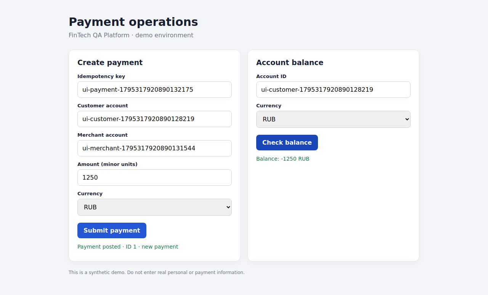
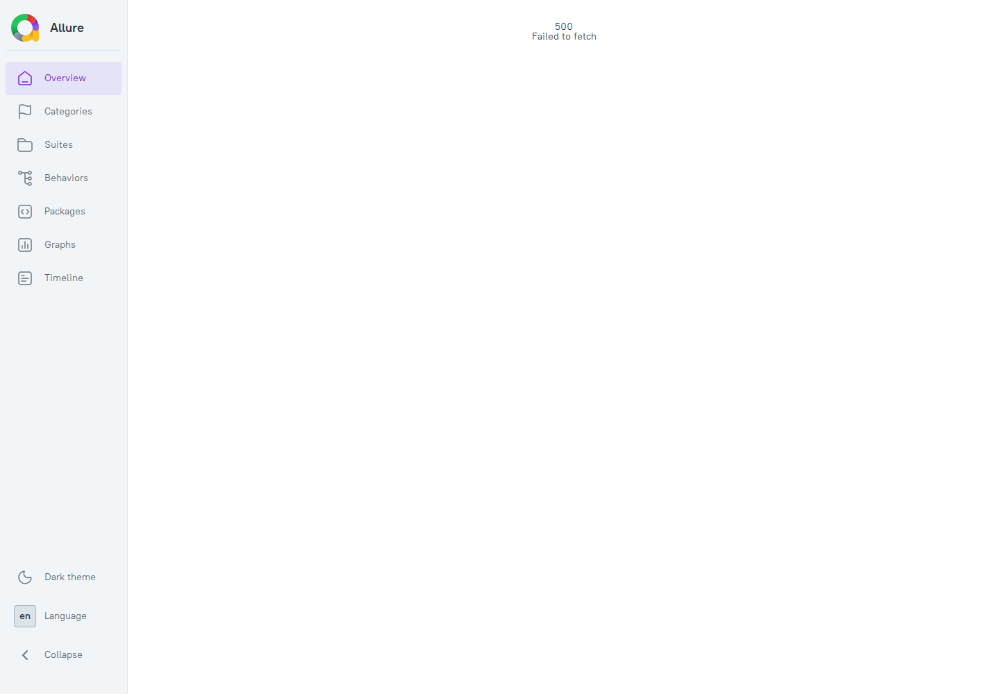

# FinTech QA Engineering Platform

[](https://github.com/blvxx/portfolio/actions/workflows/fintech-qa-platform.yml)

An end-to-end QA engineering portfolio project for a fictional payment product. It demonstrates manual test design, REST API testing, service integration, database validation, Python automation, browser E2E testing and CI reporting.

Demo environment only. No real money, banks, customer records or production systems are involved.

**Recruiter presentation:** [Open the project overview](overview.html) · [Live GitHub Pages version](https://blvxx.github.io/portfolio/fintech-qa-platform/overview.html)

## Architecture

- Payment Service accepts payment requests, validates business rules and coordinates ledger posting.
- Ledger Service records balanced debit/credit entries and exposes account balances.
- PostgreSQL persists payments, transfers and ledger entries. The services own separate tables in the demo database.
- Nginx serves a small payment operations UI and routes browser requests to the backend services.
- pytest covers isolated API behavior and cross-service contracts.
- Playwright covers browser-level payment submission, UI validation and balance verification.
- Postman provides an executable manual API collection.
- GitHub Actions runs linting, API tests, a Docker Compose integration smoke test and browser E2E tests.
- Allure generates an HTML report and preserves raw result files as CI artifacts.
- Prometheus scrapes service-level HTTP metrics; Grafana is provisioned with an operational dashboard.
- A guarded local fault-injection script stops Ledger, captures a controlled 502, restores the dependency and verifies an idempotent retry.

## Architecture diagram

```text
Playwright E2E
     |
     v
Nginx :8080  ---- static payment UI
     |                    |
     | /api/payments      | /api/accounts
     v                    v
Payment Service :8000   Ledger Service :8001
     |                    ^
     +---- HTTP transfer-+
              |
              v
         PostgreSQL
```

## Quick start

```bash
cd fintech-qa-platform
docker compose up --build
```

Open the demo UI at http://localhost:8080.

For safety, the published host ports bind to `127.0.0.1` by default. The UI, APIs, Prometheus and Grafana are intended for local evaluation; do not expose this demo stack directly to the public internet.

Services:
- Payment UI: http://localhost:8080
- Payment API docs: http://localhost:8000/docs
- Ledger API docs: http://localhost:8001/docs
- Prometheus: http://localhost:9090
- Grafana: http://localhost:3000 (demo credentials: admin / admin_demo_password)
- Payment metrics: http://localhost:8000/metrics
- Ledger metrics: http://localhost:8001/metrics

Monitoring setup, dashboard queries, incident runbooks and the [automated local fault-injection drill](observability/README.md#automated-local-fault-injection-drill) are documented in the Observability Lab.

## Run tests locally

Install dependencies and Chromium:

```bash
python -m venv .venv
pip install -r requirements.txt
python -m playwright install chromium
```

Run API tests:

```bash
pytest tests
ruff check services tests e2e
```

Run browser tests while the Docker Compose stack is running:

```bash
docker compose up --build -d
pytest e2e --alluredir=allure-results
```

Generate an HTML report (requires Java and Allure Commandline):

```bash
allure generate allure-results --clean --output allure-report
allure open allure-report
```

GitHub Actions uploads both the HTML report and raw Allure results for each E2E run, together with generated screenshots. To retain trend history between reports, copy the previous report's `history` directory into the next `allure-results/history` before generation.

## Screenshots

The screenshots below are generated by the real Playwright E2E run in GitHub Actions and attached to the run as downloadable artifacts. They are not committed automatically, which keeps CI runs isolated from concurrent repository updates.

### Payment UI — successful payment and balance check



### Allure test report



## Test coverage

### API and integration
- Payment creation and status retrieval.
- Ledger debit/credit conservation.
- Idempotent retries and conflicting key reuse.
- Invalid amounts and identical account validation.
- Payment-to-ledger dependency failure.
- API response and HTTP status assertions.
- Docker Compose smoke test against PostgreSQL.

### Browser E2E
- Successful payment submission through the UI.
- Cross-service result: customer balance reflects the payment.
- Client-side validation blocks a zero-amount payment.
- Accessible headings, labels, buttons and live status output are used as stable UI locators.

## CI artifacts

The GitHub Actions workflow publishes:
- JUnit XML for API and UI test runs.
- Allure HTML report.
- Raw Allure results, including data needed to preserve history/trends across runs.

## Latest CI evidence

The latest reviewed run on **23 November 2026** completed successfully across all three jobs:

- **Quality:** Ruff lint and automated API tests passed.
- **Compose smoke:** the payment-to-ledger transaction, idempotent replay, account-balance invariant, Prometheus/Grafana readiness and guarded local Ledger outage/recovery drill passed.
- **UI E2E:** the Docker stack started, Playwright browser tests passed, the Allure HTML report and screenshots were generated, and the evidence bundle was uploaded.

[Open the successful GitHub Actions run](https://github.com/blvxx/portfolio/actions/runs/45100258032) · [JUnit report artifact](https://github.com/blvxx/portfolio/actions/runs/45100258032/artifacts/14784877944) · [Operational drill evidence](https://github.com/blvxx/portfolio/actions/runs/45100258032/artifacts/14784644214) · [Allure report and screenshots](https://github.com/blvxx/portfolio/actions/runs/45100258032/artifacts/14784194837)

## Known limitations

- Both services use one PostgreSQL instance in this demonstration, but own separate tables.
- The payment-to-ledger call is synchronous. This is not a distributed transaction and does not implement an outbox/saga pattern.
- Authentication, authorization, rate limiting, load testing and production security controls are out of scope.
- The UI is a deliberately small test harness, not a production banking interface.
- The bug report file contains templates and illustrative examples, not claims of observed defects.

## Maintainer

Artem Kalinin — https://github.com/blvxx
