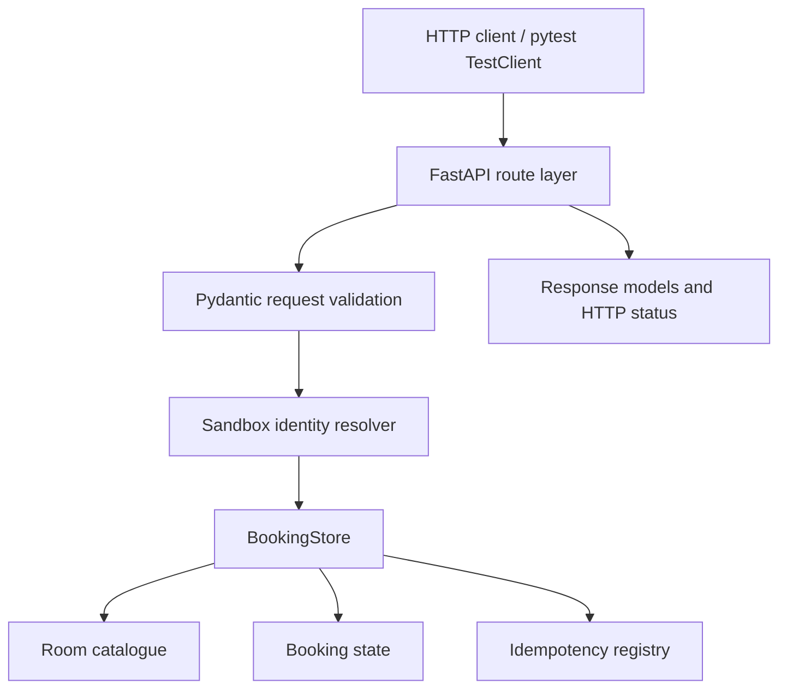
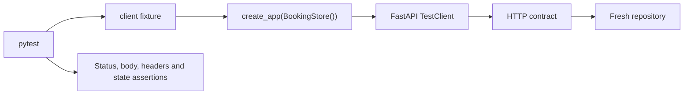

# Booking API QA Sandbox — Architecture

## Runtime architecture

## Component responsibilities

| Component | Responsibility | Quality concern |
|---|---|---|
| FastAPI route layer | HTTP endpoints and status semantics | Contract consistency |
| Pydantic models | Request parsing, constraints and response shape | Invalid input never reaches domain operation |
| Identity resolver | Resolves one of two fixed QA identities | Authentication / object ownership |
| BookingStore | Booking lifecycle, overlap checks and retries | State integrity and duplicate prevention |
| pytest fixture | Creates a fresh app and store for every test | Test isolation and order independence |

## Key design decisions

1. **Application factory.** `create_app(store)` allows each test to inject a new repository rather than mutating module-level global state.
2. **Single repository boundary.** All booking creation and lookup operations pass through `BookingStore`; route handlers do not directly mutate dictionaries.
3. **Atomic in-memory operations.** A re-entrant lock protects the booking and idempotency dictionaries in this single-process test target.
4. **Half-open date intervals.** Reservations use `[start_date, end_date)`, so adjacent stays are allowed and overlapping stays are rejected.
5. **Idempotency scope.** The key is scoped by owner. Replaying the same key and body returns the same resource; changing the payload returns 409.

## Test architecture

Each test owns its app/store instance. No test depends on a previously created booking or an external network service.

## Non-goals

This architecture is intentionally small. It does not claim distributed locking, database transaction isolation, persistent storage, OAuth/JWT, rate limiting, or production-grade concurrent booking guarantees. A production implementation would move persistence and conflict guarantees into a transactional database with unique/exclusion constraints and robust authentication.
