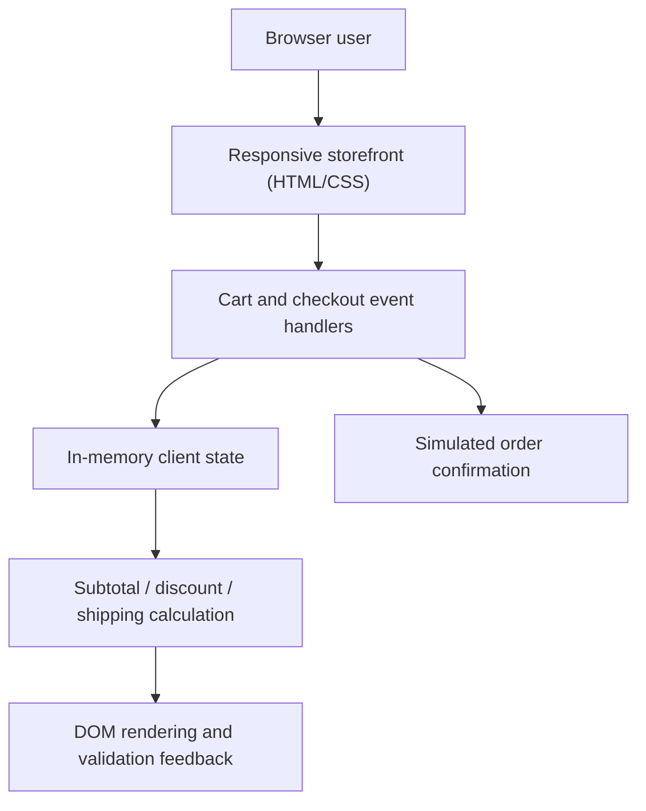
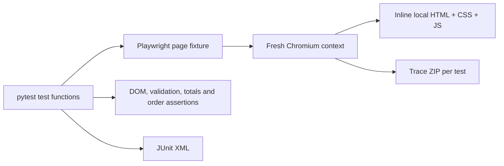

# Checkout QA Sandbox — Architecture

## Runtime architecture

## State model

| State | Storage | Invariant |
|---|---|---|
| Cart | JavaScript Map of product ID to quantity | Quantity is between 1 and available stock |
| Promotion | Boolean applied state | Repeated apply does not multiply the discount |
| Fulfilment | Selected form option | Exactly one shipping fee is included |
| Order | One session-level submission state | Repeated submit does not create another confirmation |

## Browser test architecture

The test fixture reads the checked-in app files and loads them into a browser page. This keeps the suite deterministic and independent from a local web server or external API. A fresh browser context is created for every test. Traces are retained for diagnosis, and failed tests additionally produce screenshots.

## Pricing rules

- Subtotal is the sum of item price multiplied by selected quantity.
- `SAVE10` discounts 10% of eligible items only.
- Shipping is CU 20.00 for delivery and CU 0.00 for pickup.
- Final total = subtotal − discount + shipping.
- Zero-stock products cannot be added; quantities cannot exceed available stock.

## Non-goals

This is a front-end test harness, not an e-commerce backend. It has no real inventory reservation, payment gateway, persistent orders, server-side validation, network retry, or cross-session concurrency. Duplicate submission is checked against the local UI state, not a production idempotency implementation.
